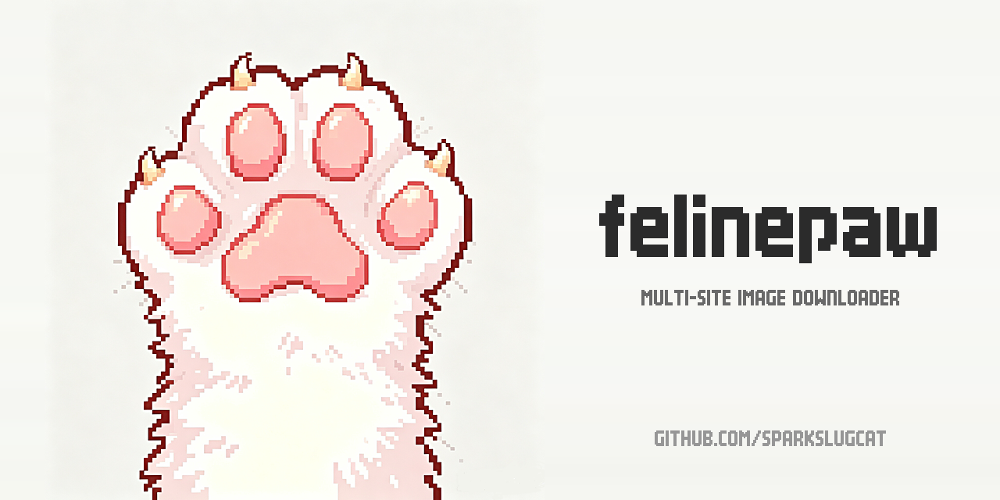

# 🐾 felinepaw



Multi-site furry image downloader scripts — **e621 / yiffverse / e-hentai / FurAffinity / BBooru / WildDream / HypnoHub / Rule34.us** in one place.
All scripts share the same CLI conventions (`-o`, `--limit`, `--proxy`, `-w`, `-d`,
`--delay`, `--jitter`, `--cooldown`, `--force`) and a common
base library ([`common.py`](common.py)) for proxy detection, sessions, resume, limits,
request pacing and a fail-fast proxy preflight.
A unified launcher ([`felinepaw_tool.py`](felinepaw_tool.py), CLI + tkinter GUI) dispatches all sites from one command.

> 多站点兽向图片下载脚本 —— **e621 / yiffverse / e-hentai / FurAffinity / BBooru / WildDream / HypnoHub / Rule34.us** 全在一处。
> 所有脚本共用同一套命令行约定（`-o`、`--limit`、`--proxy`、`-w`、`-d`、`--delay`、`--jitter`、`--cooldown`、`--force`），
> 以及一个公共基础库 [`common.py`](common.py)，负责代理探测、会话复用、断点续传、数量上限、请求节流，
> 以及发包前的快速代理预检。
> 还有一个统一入口 [`felinepaw_tool.py`](felinepaw_tool.py)（命令行 + tkinter 图形界面），一条命令调度所有站点。

> ⭐ If this project helps you, a Star would mean a lot. Thanks!
>
> 如果这个项目对你有帮助，欢迎点个 ⭐ Star，非常感谢！

---

## ⚙️ Requirements / 环境要求

| Item / 项 | Notes / 说明 |
|---|---|
| Python | **3.9 or newer** (3.9 / 3.10 / 3.11 / 3.12 all tested). Version management: [Miniconda](https://docs.conda.io/en/latest/miniconda.html) / [pyenv](https://github.com/pyenv/pyenv) recommended; the official installer works too |
| 3rd-party | `requests` (`pip install requests`); **`lxml`** is also required for e-hentai / FA / WildDream; **`DrissionPage`** is **optional** — only needed for the yiff-auto browser variant and the FA-cookies helper |
| OS | **Windows 10 / 11** (the `.bat` launcher is Windows-only); other OSes should work in theory (no Windows-only code) but are untested |
| Network | A working local proxy (Clash / mihomo on `http://127.0.0.1:7897` by default) — most of these sites are not directly reachable from mainland China |

> **Quickest start / 最省事的起步**:
>
> ```bash
> conda create -n felinepaw python=3.9 -y
> conda activate felinepaw
> pip install requests
> # 按需：pip install lxml          # 给 e-hentai / FA / WildDream
> # 按需：pip install DrissionPage  # 给 yiff-auto / FA cookies
> ```

---

## 🌐 Proxy port / 代理端口

> 90% of users can skip this section. This is for those whose local proxy is not on the default `127.0.0.1:7897`.

The tool defaults to `http://127.0.0.1:7897` (Clash / Clash Verge / mihomo mixed port).
If you changed the port (or use SS / V2RayN / NekoBox / another local proxy), change it via:

**Option 1: environment variables (recommended, persistent)**

```bat
:: Windows cmd — permanent, takes effect after reopening cmd
setx HTTP_PROXY "http://127.0.0.1:YOUR_PORT"
setx HTTPS_PROXY "http://127.0.0.1:YOUR_PORT"
```

**Option 2: command-line flag (one-off)**

```bash
python felinepaw_tool.py tag feline --proxy http://127.0.0.1:YOUR_PORT
```

**Option 3: skip the proxy (if direct connection works)**

```bash
python felinepaw_tool.py tag feline --proxy off
```

> 90% 的用户可以跳过这一节——除非你改了 Clash 的默认端口（或用 SS / V2RayN / NekoBox / 其他本地代理）。
> 默认走 `http://127.0.0.1:7897`（Clash / Clash Verge / mihomo 混合端口），改法同上。

## 🆘 Something broke? / 出问题了？

Kept short on purpose. The full guide — startup failures, missing modules, `PYTHON_EXE`,
proxy errors, rate limits, and how to file a bug — lives in **[`TROUBLESHOOTING.md`](TROUBLESHOOTING.md)**.

> 这一节故意留短。完整排错手册在 **[`TROUBLESHOOTING.md`](TROUBLESHOOTING.md)**：
> 启动失败、依赖缺失、`PYTHON_EXE` 配置、代理报错、限速，以及怎么报 bug。

The five rows below cover most first-run failures / 首次运行踩到的坑基本都在表里：

| Symptom / 现象 | Where to look / 去哪查 |
|---|---|
| `'python' is not recognized`, `pythonw.exe not found` | [TROUBLESHOOTING §3](TROUBLESHOOTING.md) — set `PYTHON_EXE` |
| `ModuleNotFoundError: No module named ...` | [TROUBLESHOOTING §2](TROUBLESHOOTING.md) — `python -m pip install requests lxml` |
| `DLL load failed while importing _tkinter` | [TROUBLESHOOTING §1](TROUBLESHOOTING.md) — `conda install -n YOUR_ENV tk` |
| Window flashes and disappears | [TROUBLESHOOTING §1](TROUBLESHOOTING.md) — run `启动.bat` from a cmd window |
| `ProxyError` / `proxy_down` / 403 | [TROUBLESHOOTING §5–6](TROUBLESHOOTING.md) — proxy and site blocks |

> Known defects and their fix status: **[`KNOWN_ISSUES.md`](KNOWN_ISSUES.md)**.
>
> 已知缺陷与修复状态：**[`KNOWN_ISSUES.md`](KNOWN_ISSUES.md)**。

---

## 🖥 No Python? Try a packaged GUI / 不装 Python？试试打包好的 GUI

If you don't have Python installed (or just don't want to touch it), the same engines ship as
ready-to-run **standalone `.exe` files** under the sister projects — **double-click and run, no
Python install required**:

> 如果你**没装 Python**（或懒得折腾），同套引擎在姊妹项目里**打包成了独立 `.exe`** —— **双击就能跑，
> 完全不需要装 Python**：

| GUI / 图形界面 | Source / 来源 | Notes / 说明 |
|---|---|---|
| **BBoorupaw.exe** | [`sites/BBooru/gui/`](sites/BBooru/gui/) — build with `build_exe.bat` (PyInstaller) | Tags / Pool / Artist modes for BBooru. Prebuilt binary is published under [Releases](../../releases) |
| **[E621Downloader.exe](https://github.com/SparkSlugcat/e621-downloader)** | [e621-downloader](https://github.com/SparkSlugcat/e621-downloader) — sibling repo | Five e621 modes (tag / tag-page / artist / pool / pool-reversed); bilingual (中文 / English) UI, live log + Stop button. Grab it from [Releases](https://github.com/SparkSlugcat/e621-downloader/releases/latest) |

> 💡 In one line: **want a `.exe` for BBooru** → grab `BBoorupaw.exe` from this repo's
> Releases; **want a `.exe` for e621** → grab `E621Downloader.exe` from the e621-downloader
> Releases. Both are double-click-and-run.
>
> 一句话：**BBooru 用 exe** → 本仓库 [Releases](../../releases) 里下 `BBoorupaw.exe`；
> **e621 用 exe** → [e621-downloader](https://github.com/SparkSlugcat/e621-downloader/releases/latest) 的 Releases 下 `E621Downloader.exe`。都是双击即用。

---

## 🚀 Quick start / 快速上手（统一入口）

```bat
python felinepaw_tool.py bbooru --tags landscape --limit 200 -o ./out
python felinepaw_tool.py bbooru --pool 33976 --limit inf -o ./out
python felinepaw_tool.py bbooru --tags <artist_tag> --mode artist -o ./out
python felinepaw_tool.py hypnohub --tags spiral --limit 50 -o ./out
python felinepaw_tool.py rule34us --tags landscape --limit 50 -o ./out
python felinepaw_tool.py wilddream "https://www.wilddream.net/art/userpage/gallery?userpagename=xxx&folderid=485" --limit inf -o ./out
```

Or launch the GUI: `python felinepaw_gui.py`

> 或者直接开图形界面：`python felinepaw_gui.py`

**Windows: just double-click `启动.bat`.** It doesn't guess environment names — it walks the
`envs` folders of any conda install under `%USERPROFILE%` / `%LOCALAPPDATA%`, runs `import requests`
inside each candidate, and keeps the first one that succeeds (if `PYTHON_EXE` is set, it wins
outright). Then it runs an import self-check, so a missing dependency shows up as a readable
traceback instead of a window that silently never appears. (A console window flashes for a moment —
that's unavoidable, since a `.bat` must be parsed by `cmd.exe`.)

> **Windows 用户：双击 `启动.bat` 就能开图形界面。** 它不猜环境名 —— 直接扫 conda 的 `envs`
> 目录，挨个试 `import requests`，谁通过就用谁（设了 `PYTHON_EXE` 就以它为准），所以排在前面的
> 环境缺库也不会被误选；随后再做一次导入自检，缺依赖时把 traceback 直接打出来，
> 而不是"双击了没反应"。命令行窗口会闪一下——那是必然的（`.bat` 必须由 `cmd.exe` 解析），不影响使用。
>
> ⚠️ 脚本里**不含任何写死的路径** —— 换机器、换 conda 环境都不用改文件；一个都扫不到时，
> 它会告诉你怎么用 `PYTHON_EXE` 指定。

## 🖥 GUI guide / 图形界面使用指南

Prefer clicking to typing? `python felinepaw_gui.py` — or just double-click `启动.bat` on Windows —
opens one window that drives every site. It has three parts:

- **任务参数** — the form at the top. Every field maps to a command-line flag, shown in parentheses
  next to its label, so the GUI and the CLI always agree.
- **▶ 开始 / ■ 停止** — run or abort, with a live status line.
- **运行日志** — the log pane at the bottom. Its **first line is the exact command being run**;
  copy that into a terminal later if you want to automate the same job.

> 不想敲命令行？`python felinepaw_gui.py`（Windows 上直接双击 `启动.bat`）会打开一个窗口，
> 所有站点都在里面操作，界面分三块：
>
> - **任务参数** —— 最上面的表单。每一格都对应一个命令行参数（参数的原始名字写在它后面的括号里），
>   所以 GUI 和命令行永远是同一套规则。
> - **▶ 开始 / ■ 停止** —— 开始跑 / 中途叫停，右边显示当前状态。
> - **运行日志** —— 最下面的大框。它**第一行会打印本次实际执行的命令**，想以后写脚本自动化，
>   照抄那一行就行。

### Fields / 参数逐项说明

Every field on the form, what it sets, and the one trap worth knowing:

> 表单上每一格的用途，以及各自需要注意的地方：

| Field / 控件 | Flag | What it does |
|---|---|---|
| **站点** | `site` | 选下载站：`e621`、`e926`、`yiff`、`ehentai`、`fa`、`bbooru`、`wilddream`、`hypnohub`、`rule34us`。选 `e926` 时「开始」会被禁用（被 Cloudflare 拦，纯 requests 进不去） |
| **模式** | `--mode` | **只对 `e621` 和 `bbooru` 生效**，其它站点这格是空的。e621 可选 `tags` / `page` / `artist` / `pool` / `pool-rev`；bbooru 可选 `auto` / `api` / `html` / `artist` |
| **目标/标签** | 位置参数 | **含义随站点变**，见下面那张表 |
| **标签(--tags)** | `--tags` | 标签搜索，多个标签用空格隔开，如 `cute fox` |
| **输出目录** | `-o` | 图片存到哪。留空 = 当前目录 |
| **数量限制** | `--limit` | 下多少张。填 `inf` = 全部；**留空 = 脚本默认 120 张，不是全部** |
| **代理** | `--proxy` | 留空 = 自动探测；`off` = 直连；也可填 `http://127.0.0.1:7897` |
| **页码(--page)** | `--page` | 只下某一页。对 e621 的 `page` 模式、bbooru、hypnohub、rule34us 有效。**留空 = 翻全部页** |
| **artist 跳过非池帖** | `--skip-others` | **e621 / bbooru** 的 artist 模式：不属于任何池子的帖子不下载 |
| **全量查池** | `--force-pool-check` | 仅 bbooru 的 artist 模式：默认只探测前 10 个帖子，勾上则全部查一遍 |
| **pool 反转编号** | `--pool-rev` | 仅 bbooru 池子下载：文件编号倒序 |
| **重新下载(--force)** | `--force` | 已经存在的图也重新下一遍（修复下到一半的坏文件）。对 bbooru / hypnohub / rule34us / e-hentai 生效 |
| **挑序号(--pick)** | `--pick` | **e-hentai / e621 artist / bbooru**：只下名单里的第几项，如 `2-4,7` |
| **每画廊限张(--pages)** | `--pages` | 仅 e-hentai：每个画廊只取前 N 张 |
| **只列名单(--dry-run)** | `--dry-run` | **e-hentai / e621 artist / bbooru / hypnohub / rule34us**：只列出会下哪些，不真下 |

> 中文速览（同一张表，逐条）：
>
> - **站点**：选站。`e926` 会被禁用（Cloudflare 拦截），想下安全版请用 `e621` 或浏览器。
> - **模式**：只有 e621 / bbooru 有；e621 = 标签/分页/艺术家/池/池反转，bbooru = 自动/API/HTML/艺术家。
> - **目标/标签** 与 **标签(--tags)**：两格的分工随站点变，见下一张表 —— **这是最常填错的地方**。
> - **输出目录**：留空就下到当前目录，建议每次都点「浏览...」指定一个。
> - **数量限制**：`inf` = 全部；**留空不是"不限"，是脚本默认的 120 张**。
> - **代理**：留空让它自动探测；本机 Clash 在跑、又提示连不上时，可以显式填 `http://127.0.0.1:7897`。
> - **页码**：留空 = 翻全部页；填了才只下那一页。
> - **artist 跳过非池帖**：`e621` 和 `bbooru` 的 artist 模式都能用 —— 不下不属于任何池子的帖子。
> - **全量查池 / pool 反转编号**：这两格只有 bbooru 用；e621 侧对应的是「模式」下拉里的 `pool-rev`。
> - **重新下载 / 挑序号 / 每画廊限张 / 只列名单**：按括号里写的站点生效，用不到就留空、不勾。

**「目标/标签」这一格到底填什么，取决于站点：**

| Site | What goes in 目标/标签 |
|---|---|
| `e621` / `e926` | 模式选 `pool` / `pool-rev` 时填池子 URL（如 `https://e621.net/pools/123`）；其它模式不用填，改用**标签**格 |
| `yiff` | 标签 |
| `ehentai` | 画廊 URL；**标签搜索**请用**标签**格 |
| `fa` | 作品 URL |
| `bbooru` | 池子 URL 或纯数字 id（如 `33976`）。填了这里就**不要**再填**标签**格 |
| `wilddream` | 画廊 URL |
| `hypnohub` / `rule34us` | 不用填，标签一律写在**标签**格 |

> 一句话记法：**能"按标签找"的站（hypnohub / rule34us / bbooru 标签模式）用「标签」格；
> 需要"直接指一个具体东西"的（画廊 URL、作品 URL、池子）用「目标/标签」格。**
> bbooru 是个例外 —— 它两种都能做，靠"哪个格子有内容"来区分：标签格有内容 = 按标签下；
> 标签格空着、目标格有内容 = 当池子下。

### FA credentials / FA 站凭据（选 `fa` 时才出现）

`fa` is the only site that needs a login. Selecting it reveals an **FA login** panel below the
parameter area; switching to any other site hides it again.
`fa` 是唯一需要登录态的站点。选中它之后参数区下方会多出 **「FA 登录」** 面板，切到别的站点自动收起。

| Field / 字段 | What it does / 作用 |
|---|---|
| 账号 / 密码 | 直接登录用。密码经**环境变量**传给子进程 —— 不进命令行、不进日志框、不进进程列表 |
| cookie 文件 | 已经用 `FA_get_cookies.py` 导出过 cookie 就填这里；**优先于**账号密码 |
| 保存账号 | 把上面三项记在本机（项目根的 `.faenv`），下次打开自动填好 |

> **Local build vs. uploaded build / 本地版 vs 上传版**
> `.faenv` is machine-local (plain-text password, gitignored). A fresh clone has no such file, so the
> panel starts empty — same behaviour, you just retype the credentials.
>
> `.faenv` 是本机专属文件（明文密码，已写进 `.gitignore`）。别人 clone 这个仓库时没有它，
> 面板就是空的 —— 功能完全一样，只是每次得重填。
>
> Hitting FA's captcha (`fa-captcha`)? Run `python sites/furaffinity/FA_get_cookies.py` **in a
> terminal** once (it opens a real browser so you can solve it by hand), then put the exported
> `fa_cookies.json` into the cookie field.
>
> 撞验证码时，先在**终端**里跑一次这个脚本（会弹真浏览器让你手过），再把导出的 json 填进 cookie 格。
> 它不能在 GUI 里跑：既要问你账号密码，又要等你操作浏览器。
>
> FA sits behind Cloudflare. If a request is met with a browser challenge (the page says
> "Just a moment..." / "Enable JavaScript and cookies to continue"), the script says so explicitly —
> that is **not** a password problem, and no cookie juggling will get around it.
> Run `FA_get_cookies.py` in a real browser once; its exported cookies are what make the
> requests-based scraping work afterwards.
>
> FA 整站在 Cloudflare 后面。如果请求被拦成浏览器验证（页面写着 `Just a moment...` /
> `Enable JavaScript and cookies to continue`），脚本会直接说明 —— **这不是密码问题**，
> 换 cookie、换 UA 都没用。用真浏览器跑一次 `FA_get_cookies.py`，导出的 cookie 才是后面
> requests 抓取能跑通的关键。

### Scenario 1 — 按标签批量下载（以 rule34.us 为代表）


The most common job: "give me everything tagged X, on this site".

1. **站点** → `rule34us`
2. **标签(--tags)** → your tags, space-separated, e.g. `landscape` or `cute dog`
3. **数量限制** → e.g. `50`, or `inf` for everything
4. **页码** → leave empty (that means "all pages")
5. **输出目录** → click 浏览... and pick a folder
6. Press **▶ 开始**

HypnoHub works exactly the same way — just switch **站点** to `hypnohub`.

> 这是最常用的场景：「把这个站上带某标签的图都给我」。
>
> 1. **站点** 选 `rule34us`
> 2. **标签(--tags)** 填标签，多个用空格隔开，例如 `landscape` 或 `cute dog`
> 3. **数量限制** 填 `50`（或者 `inf` 表示全部）
> 4. **页码** 留空（留空就是翻全部页）
> 5. **输出目录** 点「浏览...」选一个文件夹
> 6. 点 **▶ 开始**
>
> **HypnoHub 的操作完全相同**，只是把「站点」换成 `hypnohub`。
> 这两个站都走 HTML 页面、都用「标签」格，是"标签下载"最典型的样子。

### Scenario 2 — BBooru 艺术家下载（artist 模式）

Answers "which pools does this artist's tag show up in, and what else is inside those pools".
The engine groups results **by pool**, each pool landing in its own folder; posts that belong to
no pool go to `others/`.

1. **站点** → `bbooru`
2. **模式** → `artist`
3. **标签(--tags)** → the artist tag
4. Optional: tick **artist 跳过非池帖** to drop `others/` entirely
5. Optional: tick **全量查池** if you suspect pools only appear further down the list
   (by default only the first 10 posts are probed, and the scan stops early when nothing is found)
6. **输出目录** → pick a folder, then **▶ 开始**

> 它回答的是「这个艺术家的标签出现在哪些池子里，那些池子里还有些什么」。下载结果**按池子分文件夹**，
> 不属于任何池子的帖子进 `others/`。
>
> 1. **站点** 选 `bbooru`
> 2. **模式** 选 `artist`
> 3. **标签(--tags)** 填艺术家标签 —— 注意艺术家名填在**标签格**，不是「目标/标签」格
> 4. 可选：勾 **artist 跳过非池帖**，就不要 `others/` 那个文件夹了
> 5. 可选：勾 **全量查池**。默认只探测前 10 个帖子，一旦没发现池子就提前收工；
>    你要是知道池子出现在列表靠后的位置，就勾上让它全查一遍
> 6. **输出目录** 选个文件夹，点 **▶ 开始**
>
> 原理细节见下面「BBooru artist mode」一节。

**e621 has the same artist mode.** Switch **站点** to `e621`, set **模式** to `artist`, and put the
artist tag in **标签(--tags)** as usual. Results are still grouped by pool, non-pool posts still go to
`others/`, and **artist 跳过非池帖** works here too. e621 adds one extra step: tick
**只列名单(--dry-run)** to see the list first, then use **挑序号(--pick 2-4,7)** to download only the
entries you want — one entry is one pool (or `others/`), numbered exactly as `--dry-run` prints it.

> **e621 也有 artist 模式，规则跟 bbooru 一样。** 把「站点」换成 `e621`、「模式」选 `artist`，
> 艺术家标签照旧填在「标签(--tags)」格 —— 同样是按池子分文件夹、非池作品进 `others/`，
> **「artist 跳过非池帖」照样有效**。
> e621 侧还多一档：先勾「只列名单(--dry-run)」看一遍，再在「挑序号(--pick)」里填 `2-4,7` 挑着下。
> 名单的一项 = 一个池子（或 `others/`），序号就是 `--dry-run` 打印出来的那个 `#`。
> 注意 e621 的「全量查池」「pool 反转编号」两个勾选框**不生效** —— 前者是 bbooru 专属，
> 后者在 e621 要靠「模式」下拉里的 `pool-rev`。

### Scenario 3 — BBooru 池子下载（pool 模式）

Download one specific collection, in order.

1. **站点** → `bbooru`
2. **目标/标签** → the pool's **show-page URL**, or just its numeric id
   (either `https://bbooru.com/index.php?page=pool&s=show&id=33976` or `33976`)
3. **标签(--tags)** → **leave empty** (this is what tells the GUI you mean a pool)
4. Optional: tick **pool 反转编号** to number the files in reverse order
5. **输出目录** → pick a folder, then **▶ 开始**

> 下载某个指定合集，按顺序编好号。
>
> 1. **站点** 选 `bbooru`
> 2. **目标/标签** 填池子的 **show 页 URL**，或者只填那串数字 id
>    （`https://bbooru.com/index.php?page=pool&s=show&id=33976` 和 `33976` 都行）
> 3. **标签(--tags)** **留空** —— 正是"标签格空着、目标格有内容"这一点，让 GUI 知道你要下的是池子
> 4. 可选：勾 **pool 反转编号**，文件编号就倒过来
> 5. **输出目录** 选个文件夹，点 **▶ 开始**
>
> 普通标签下载（不分组、不下池子）也很简单：**模式** 留 `auto`，「标签」格填标签即可 ——
> `auto` 表示优先用 JSON API，失败自动回退 HTML。

## 📦 Sites / 支持的站点

| Site | Scripts | Notes |
|---|---|---|
| **e621 / e926** | `sites/e621/` | Official JSON API. Credentials via `E621_USER` / `E621_KEY` env vars (guest if unset). 🖥 **GUI version → [e621-downloader](https://github.com/SparkSlugcat/e621-downloader)** |
| **yiffverse** | `sites/yiff/` | SSR + browser-auto (DrissionPage) variants; no pools, tag-based |
| **e-hentai** | `sites/e-hentai/` | Official `gdata` API for metadata + HTML for image links. **Tag search** (`--tags`), **dry-run list + pick by index** (`--dry-run` / `--pick 2-4,7`), cursor paging (`&next=<gid>`) |
| **FurAffinity** | `sites/furaffinity/` | Title-normalization series detection; login via cookies (`FA_get_cookies.py`) |
| **BBooru** | `sites/BBooru/B_scraper.py` | Gelbooru-style built-in JSON API, **no API key**. Tags (`--tags`), pools (`--pool <show URL / id>`), auto HTML fallback, `--adult y/n`, **artist mode** (pool-grouped download), **GUI/exe** in `gui/` |
| **WildDream** | `sites/wilddream/W_scraper.py` | Comic-gallery (folder) downloads from a gallery URL; polite throttling + atomic `.part` resume; threaded (`--threads`); `--limit` default 80 |
| **HypnoHub** | `sites/hypnohub/H_scraper.py` | Gelbooru/Shimmie engine, **HTML only** (no usable JSON API); original taken from `img#image`; `--page` for a single page |
| **Rule34.us** | `sites/rule34us/R_scraper.py` | Custom engine, **HTML only**; original linked by `<li class="character-tag">Original</li>`; automatic pagination probe |

> **中文速览**
>
> - **e621 / e926** —— `sites/e621/`：官方 JSON API，凭据走 `E621_USER` / `E621_KEY` 环境变量（不设则以游客身份）。🖥 图形界面版 → [e621-downloader](https://github.com/SparkSlugcat/e621-downloader)
> - **yiffverse** —— `sites/yiff/`：SSR 版 + 浏览器自动加载版（DrissionPage）两种；没有池子，只按标签。
> - **e-hentai** —— `sites/e-hentai/`：官方 `gdata` API 取元数据 + HTML 取图片链接。支持**标签搜索**（`--tags`）、**dry-run 出名单再按序号挑**（`--dry-run` / `--pick 2-4,7`）、游标翻页（`&next=<gid>`）。
> - **FurAffinity** —— `sites/furaffinity/`：靠标题规范化识别系列；用 cookies 登录（`FA_get_cookies.py`）。
> - **BBooru** —— `sites/BBooru/B_scraper.py`：Gelbooru 系内置 JSON API，**不需要 API key**。标签（`--tags`）、池子（`--pool <show URL / id>`）、自动 HTML 兜底、`--adult y/n`、**artist 模式**（按池分组下载）、`gui/` 里有图形界面 / exe。
> - **WildDream** —— `sites/wilddream/W_scraper.py`：从画廊 URL 下载整本漫画（文件夹）；礼貌节流 + `.part` 原子续传；多线程（`--threads`）；`--limit` 默认 80。
> - **HypnoHub** —— `sites/hypnohub/H_scraper.py`：Gelbooru / Shimmie 引擎，**只有 HTML**（没有可用的 JSON API）；原图取 `img#image`；`--page` 指定单页。
> - **Rule34.us** —— `sites/rule34us/R_scraper.py`：自建引擎，**只有 HTML**；原图由 `<li class="character-tag">Original</li>` 给出；自动探测翻页。

## ✨ Common features / 通用特性

- **Proxy auto-detect** — follows Windows system proxy / env vars (`--proxy off` to disable)
- **Proxy preflight (fail-fast)** — before a run, one TCP probe + one no-retry GET tell you in
  ~1s whether the proxy port is even listening, instead of hanging for tens of seconds on a
  `ProxyError`. `--no-preflight` skips it. `proxy_down` / `bad_proxy_url` abort the run;
  everything else only warns
- **`--limit`** — default 120 (WildDream: 80), `--limit N`, `--limit inf` (download everything)
- **Resume** — existing files are skipped (atomic `.part` + rename on BBooru / WildDream / HypnoHub / Rule34.us)
- **`--force`** — re-download files that already exist (BBooru / HypnoHub / Rule34.us),
  useful for repairing half-written images
- **Request pacing** — BBooru / HypnoHub / Rule34.us accept `--delay` (base interval) and
  `--jitter` (random extra), so traffic doesn't look machine-regular; on HTTP 429/503 every
  worker thread backs off together for `--cooldown` seconds (default 20) instead of each
  thread hitting the wall on its own. Defaults (`0` / `0`) keep the old behaviour
  (e-hentai / FurAffinity use `-d` as a random delay cap, which equals `--delay 0 --jitter d`)
- **Concurrency** — threaded downloads (BBooru / WildDream / HypnoHub / Rule34.us: `--threads`) with polite delays
- **Named-list workflow (e-hentai)** — `--dry-run` prints the list **and** saves it to a JSON
  manifest; `--pick 2-4,7` downloads exactly those rows. Search results drift as new uploads
  appear, so the saved manifest is what makes `--pick` reproducible
  (`--from-manifest eh_manifest.json --pick 2-4,7`). The same `--pick` syntax (`2-4,7` / `3-` /
  `-3` / `all`) lives in `common.py`, so other sites can reuse it
- **No hardcoded credentials** — env vars / cookies only
- **Console-safe output** — GBK-safe ASCII markers (no emoji that crash cp936 terminals)
- **Uniform file naming** — `p<post_id>.<ext>` across the booru sites, so resume works across modes

> **中文**
>
> - **代理自动探测** —— 跟随 Windows 系统代理 / 环境变量（`--proxy off` 可关掉）
> - **代理预检（fail-fast）** —— 开跑前先做一次 TCP 探测 + 一次不重试的 GET，约 1 秒内告诉你代理端口到底有没有在监听，而不是卡在 `ProxyError` 上几十秒。`--no-preflight` 可跳过。`proxy_down` / `bad_proxy_url` 会中止本次运行，其余情况只警告
> - **`--limit`** —— 默认 120（WildDream：80），`--limit N` 取 N 个，`--limit inf` 全部下载
> - **断点续传** —— 已存在的文件跳过（BBooru / WildDream / HypnoHub / Rule34.us 用 `.part` + 改名原子落盘）
> - **`--force`** —— 重下已存在的文件（BBooru / HypnoHub / Rule34.us），适合修下到一半的坏图
> - **请求节流** —— BBooru / HypnoHub / Rule34.us 支持 `--delay`（基准间隔）和 `--jitter`（随机额外量），让流量看起来不像机器在定时打点；遇到 HTTP 429/503 时所有工作线程一起退避 `--cooldown` 秒（默认 20），而不是各自撞墙。默认值（`0` / `0`）保持原行为（e-hentai / FurAffinity 的 `-d` 是随机延迟上限，等价于 `--delay 0 --jitter d`）
> - **并发** —— 多线程下载（BBooru / WildDream / HypnoHub / Rule34.us：`--threads`），带礼貌延时
> - **名单工作流（e-hentai）** —— `--dry-run` 打印名单**并**存成 JSON 清单文件；`--pick 2-4,7` 精确下载这几行。搜索结果会随新投稿漂移，所以存下来的清单才是 `--pick` 可复现的关键（`--from-manifest eh_manifest.json --pick 2-4,7`）。同一套 `--pick` 语法（`2-4,7` / `3-` / `-3` / `all`）在 `common.py` 里，其他站点可以复用
> - **不硬编码凭据** —— 只用环境变量 / cookies
> - **控制台安全输出** —— GBK 安全的 ASCII 标记（不用会让 cp936 终端崩掉的 emoji）
> - **统一文件命名** —— booru 各站统一 `p<post_id>.<ext>`，跨模式也能续传

## 🚀 Usage / 用法

```bat
:: e621（凭据可选，用环境变量）
set E621_USER=yourname & set E621_KEY=yourkey
python sites/e621/e6_scraper.py --tags feline -o ./feline

:: yiffverse（每标签 SSR 仅约 30 帖；浏览器版可滚动加载更多）
python sites/yiff/yiff_scraper.py feline --limit 50

:: e-hentai（单画廊）
python sites/e-hentai/EH_scraper_v2.py "https://e-hentai.org/g/xxx/yyy/" -o ./gallery

:: e-hentai（标签搜索 → 只看名单，不下载）
python sites/e-hentai/EH_scraper_v2.py --tags "language:chinese$ female:anal" --limit 30 --dry-run

:: e-hentai（挑着下：名单里的第 2,3,4,7 个）
python sites/e-hentai/EH_scraper_v2.py --tags "language:chinese$" --limit 30 --pick 2-4,7

:: e-hentai（精确复现：从名单文件挑，不受搜索结果变动影响）
python sites/e-hentai/EH_scraper_v2.py --from-manifest eh_manifest.json --pick 2-4,7

:: e-hentai（搜索模式下每个画廊只取前 5 张，免得一次拉满）
python sites/e-hentai/EH_scraper_v2.py --tags "language:chinese$" --limit 30 --pages 5

:: FurAffinity（需登录；先导出 cookies）
python sites/furaffinity/FA_get_cookies.py
python sites/furaffinity/FA_scraper.py "https://www.furaffinity.net/view/xxx/" --cookies fa_cookies.json

:: BBooru（JSON API；池子两种输入方式均可；--adult n 只看 general/safe，对应站内 set=general）
python sites/BBooru/B_scraper.py --tags "cute fox" --limit 100 --threads 12 -o ./out
python sites/BBooru/B_scraper.py --pool https://bbooru.com/index.php?page=pool&s=show&id=33976 -o ./out

:: BBooru artist 模式（按 pool 分组；不属于任何 pool 的进 others/）
python sites/BBooru/B_scraper.py --tags <artist_tag> --mode artist -o ./out
python sites/BBooru/B_scraper.py --tags <artist_tag> --mode artist --skip-others -o ./out
python sites/BBooru/B_scraper.py --tags <artist_tag> --mode artist --force-pool-check -o ./out

:: BBooru 单页 / 反转编号
python sites/BBooru/B_scraper.py --tags fox --page 2 -o ./out
python sites/BBooru/B_scraper.py --pool 33976 --pool-rev -o ./out

:: HypnoHub（纯 HTML，需代理；--adult n 时不显示成人原图）
python sites/hypnohub/H_scraper.py --tags spiral --limit 50 --threads 8 -o ./out

:: Rule34.us（纯 HTML；翻页自动探测）
python sites/rule34us/R_scraper.py --tags landscape --limit 50 --threads 8 -o ./out

:: WildDream（整本漫画；URL 两种形态自动兼容；--threads 并发下载）
python sites/wilddream/W_scraper.py "https://www.wilddream.net/art/userpage/gallery?userpagename=xxx&folderid=485" --limit inf --threads 12 -o ./out

:: 被站点限速时：放慢节奏 + 撞到 429 时全体刹车（bbooru / hypnohub / rule34us）
python sites/BBooru/B_scraper.py --tags fox --delay 1 --jitter 1.5 --cooldown 30 --threads 4 -o ./out

:: 重新下载已存在的图（修下到一半的坏文件；bbooru / hypnohub / rule34us）
python sites/hypnohub/H_scraper.py --tags spiral --force -o ./out

:: 链路正常但预检误报时，跳过预检
python sites/rule34us/R_scraper.py --tags landscape --no-preflight -o ./out
```

Dependencies: `requests` (+ `lxml` for e-hentai / FA / WildDream, + DrissionPage for yiff-auto / FA cookies).

> 依赖：`requests`（e-hentai / FA / WildDream 另需 `lxml`；yiff-auto / FA 取 cookies 另需 DrissionPage）。

### BBooru artist mode / 艺术家模式说明

Artist mode answers "which pools does this tag appear in, and what else is in them":

1. Search the tag through the JSON API (fast — one request per 100 posts, originals via `file_url`).
2. Check each post's `post-pool-list` page to learn which pools it belongs to.
3. For every pool found, fetch that pool's full post list and download it into its own folder.
4. Posts that are in no pool go to `others/` (add `--skip-others` to drop them).

Only the first 10 posts are probed by default; if none of them belongs to a pool the remaining
checks are skipped — that is the common case, since most tags have no pools at all. Use
`--force-pool-check` for a full scan when you suspect pools appear later in the list.

> 艺术家模式回答的是「这个标签出现在哪些池子里，那些池子里还有什么别的东西」：
>
> 1. 先用 JSON API 搜这个标签（很快 —— 每 100 帖一个请求，原图从 `file_url` 取）。
> 2. 逐个查帖子的 `post-pool-list` 页，看它属于哪些池子。
> 3. 对每个找到的池子，拉它的完整帖子列表，下到自己的文件夹里。
> 4. 不属于任何池子的帖子进 `others/`（加 `--skip-others` 就丢弃）。
>
> 默认只探测前 10 个帖子；如果一个池子都没命中，剩下的检查就跳过 —— 这是常见情况，因为大多数标签根本没有池子。
> 怀疑池子出现在列表后面时，用 `--force-pool-check` 做全量扫描。

## 🖥 BBooru GUI / standalone exe（图形界面版）

Don't want to touch the command line? `sites/BBooru/gui/` wraps the same engine in a tkinter GUI
and can be frozen into a single `.exe`:

> 不想碰命令行？`sites/BBooru/gui/` 把同一套引擎包进 tkinter 图形界面，还能冻成单文件 `.exe`：

```bat
python sites/BBooru/gui/app.py      :: run the GUI from source
cd sites/BBooru/gui & build_exe.bat :: build dist\BBoorupaw.exe (needs PyInstaller)
```

The GUI calls `B_scraper.main(argv)` **in-process** (no subprocess), pipes the engine log into the
window and wires the Stop button to the engine's `request_cancel()`. It exposes the same three
modes as the CLI: tags / pool / artist.

> 图形界面**同进程**调用 `B_scraper.main(argv)`（不是起子进程），把引擎日志接到窗口里，Stop 按钮直接调引擎的 `request_cancel()`。
> 三种模式和命令行完全一致：标签 / 池子 / 艺术家。

It also has a **"☑ 挑着下载" (pick) button**: it collects the list first (nothing is downloaded), opens a
tick-box window grouped exactly like the CLI numbering, and then downloads only the rows you left checked
(internally `--pick 2,4,7`). Cancel the dialog and nothing is downloaded.

> 界面上还有个 **「☑ 挑着下载」** 按钮：先只收集列表（一张图都不下），弹出一个带勾选框的窗口
> （编号和命令行 `--dry-run` 完全一致），只下你留下的那些（内部就是 `--pick 2,4,7`）。
> 不想下就点「取消」，什么都不会下载。

> Prebuilt `BBoorupaw.exe` is published under
> [Releases](../../releases) rather than committed here — an 18 MB binary in git history would
> bloat every clone forever. (It was called `BBooruPaw.exe` up to v1; renamed in v1.1 to match the
> name in the PyInstaller spec.)
>
> 预编译的 `BBoorupaw.exe` 发布在 [Releases](../../releases) 里，**不进仓库** —— 18 MB 的二进制塞进 git 历史会让每次 clone 都变重。
> （v1 时叫 `BBooruPaw.exe`，v1.1 起与 spec 里的名字统一。）

## 🔒 Security / 安全

- Scripts contain **no real credentials**. e621 keys come from env vars; FA uses a local cookies file.
- `fa_cookies.json` and any `config.json` are **sensitive** — never commit them (see `.gitignore`).
- Downloaded content folders are **not** part of the repo — keep them out of commits.
- **FA credentials are never passed on the command line.** The GUI hands the password to the child
  process through the `FA_PASSWORD` environment variable instead, so it does not appear in the log
  box, in the printed command line, or in the OS process list.
- `.faenv` holds FA credentials in **plain text** and is gitignored. Treat it like a password file.

> - 脚本里**没有任何真实凭据**。e621 的 key 走环境变量；FA 用本地 cookies 文件。
> - `fa_cookies.json` 和任何 `config.json` 都是**敏感文件** —— 绝不要提交（见 `.gitignore`）。
> - 下载的内容文件夹**不属于**仓库 —— 别把它们提交进去。
> - **FA 的凭据不上命令行。** GUI 把密码通过 `FA_PASSWORD` 环境变量交给子进程，
>   所以它不会出现在日志框、不会出现在打印出来的命令行里、也不会出现在系统进程列表中。
> - `.faenv` 里是**明文** FA 凭据，已 gitignore。请把它当密码文件对待。

## 🐞 Known issues / 已知问题

Every measured defect — symptom, root cause, fix and how it was verified — is catalogued in
**[`KNOWN_ISSUES.md`](KNOWN_ISSUES.md)**, with its status and the files it touched. Only
**reproduced** issues are listed there; no speculation.

> 所有实测过的缺陷（现象、根因、修法、验证方式）都记录在 **[`KNOWN_ISSUES.md`](KNOWN_ISSUES.md)**，
> 附带状态与涉及文件。那里只收**能复现**的问题，不做猜测。

All eight entries are fixed today. Two are still worth remembering, because they can make old logs
look like new bugs / 八条目前全部已修，其中两条值得记住 —— 它们会让旧日志看起来像新 bug：

| # | In one line / 一句话 |
|---|---|
| **#2** | e-hentai search is **cursor-paged**: `&page=N` is silently ignored, so a `page=N` loop re-fetches page 1 forever |
| **#4** | `--pick` keeps the **original list index** in filenames; renumbering causes silent skips on resume |

> **#2** e-hentai 搜索是**游标翻页**，`&page=N` 被静默忽略 —— 用 `page=N` 循环会一直重复下第一页。
>
> **#4** `--pick` 落盘保留**原名单序号**，重新编号会让续传静默跳图。

## ⚠️ Disclaimers / 免责声明

- These tools are intended **only for personal appreciation, translation and learning**.
  **Commercial use or illegal profit-making is strictly prohibited.** Users bear all responsibility.
- **FurAffinity** explicitly prohibits automated bulk downloads in its ToS — using the FA scripts
  may risk your account. Use at your own risk; the author is not liable for any account action.
- **e621 / e-hentai / BBooru / WildDream / HypnoHub / Rule34.us**: comply with each site's API /
  automation guidelines and avoid excessive request rates; these are adult-oriented sites and the
  scripts include adult-rated content by default (`--adult`), use responsibly.
- Use at your own risk. The author is not liable for downloaded content or account safety.

> - 这些工具**仅供个人欣赏、翻译和学习**使用。**严禁商业用途或非法盈利**，责任由使用者自负。
> - **FurAffinity** 的服务条款明确禁止自动化批量下载 —— 用 FA 脚本可能危及你的账号。风险自负，作者不对任何账号处置负责。
> - **e621 / e-hentai / BBooru / WildDream / HypnoHub / Rule34.us**：请遵守各站点的 API / 自动化规范，避免过高的请求频率；
>   这些都是成人向站点，脚本默认就包含成人分级内容（`--adult`），请自行斟酌使用。
> - 使用风险自负。作者不对下载到的内容、也不对账号安全承担任何责任。

## 🔗 Related / 相关项目

### 🖥 [e621-downloader](https://github.com/SparkSlugcat/e621-downloader) — e621 的图形界面版

不想敲命令行？这是 e621 专用的 tkinter GUI，**免装 Python**，下载一个 exe 双击就能用。

[](https://github.com/SparkSlugcat/e621-downloader/releases/latest)
[](https://github.com/SparkSlugcat/e621-downloader/stargazers)

- **No Python required** — grab `E621Downloader.exe` from
  [Releases](https://github.com/SparkSlugcat/e621-downloader/releases/latest) and double-click
- **Tag / Tag-page / Artist** download modes, bilingual (中文 / English) UI, live log + Stop button
- Shares the same engine design as the CLI scripts in [`sites/e621/`](sites/e621/) here

> - **无需 Python** —— 从 [Releases](https://github.com/SparkSlugcat/e621-downloader/releases/latest) 下载 `E621Downloader.exe` 双击即用
> - **标签 / 标签分页 / 画师** 三种下载模式，中英双语界面，实时日志 + 停止按钮
> - 与这里的 [`sites/e621/`](sites/e621/) 命令行脚本共用同一套引擎设计

> 💡 一句话：**想要命令行** → 用本仓库的 `sites/e621/`；**想要鼠标点** → 用 e621-downloader。

### 🖼 [e-hentai-paw](https://github.com/SparkSlugcat/e-hentai-paw) — e-hentai 专用版

For e-hentai galleries specifically: tag search, a **scan-then-pick** workflow (list the results,
tick the ones you want, then download), and **both a CLI and a GUI** in one folder.

[](https://github.com/SparkSlugcat/e-hentai-paw/stargazers)

- **CLI + GUI in one folder** — double-click `e-hentai启动.bat` or `启动GUI.bat`, or call the script directly
- **Scan first, then pick** — `--dry-run` lists the galleries, `--pick 2-4,7` downloads only those
- **Self-contained** — ships its own copy of `common.py`, so the folder can be copied and used on its own

> - **同一个文件夹里既有命令行也有图形界面** —— 双击 `e-hentai启动.bat` 或 `启动GUI.bat`
> - **先看名单再挑着下** —— `--dry-run` 列出画廊，`--pick 2-4,7` 只下选中的那几个
> - **自包含** —— 自带一份 `common.py`，整个文件夹拷走就能独立使用

> 💡 一句话：**只下 e-hentai** → 用 e-hentai-paw；**要一个入口调所有站点** → 就是本仓库。

---

## 📁 Layout / 结构

```
felinepaw/
├── common.py               # shared base library / 公共基础库
├── KNOWN_ISSUES.md         # verified issues, with repro + suggested fixes / 已复现的问题，含复现步骤与建议修法
├── TROUBLESHOOTING.md      # startup / dependency / proxy / rate-limit troubleshooting / 排错手册（启动、依赖、代理、限速）
├── assets/                 # icon + README banner / 图标与封面图
├── felinepaw_tool.py       # unified CLI launcher (all sites, whitelist param passthrough) / 统一命令行入口（全站点，白名单参数透传）
├── felinepaw_gui.py        # unified tkinter GUI / 统一 tkinter 图形界面
├── local_creds.py          # machine-local credential shortcut, reads .faenv (gitignored) / 本机凭据快捷通道（读被 gitignore 的 .faenv）
├── 启动.bat               # Windows: double-click → GUI (auto-detects Python + import self-check) / Windows 双击启动图形界面（自动定位 Python + 导入自检）
└── sites/
    ├── e621/               # 5 CLI scripts (tags / page / artist / pool / pool-reversed) / 5 个 CLI 脚本（标签 / 分页 / 画师 / 池子 / 池子反转）
    ├── e-hentai/           # EH_scraper_v2.py (API + HTML)
    ├── yiff/               # yiff_scraper.py + yiff_auto_scraper.py (browser) / （浏览器版）
    ├── furaffinity/        # FA_scraper.py + FA_get_cookies.py
    ├── BBooru/             # B_scraper.py (JSON API tags / pools / artist mode) / （JSON API：标签 / 池子 / 艺术家模式）
    │   └── gui/            # app.py + BBoorupaw.spec (tkinter GUI / single-file exe) / （tkinter 界面 / 单文件 exe）
    ├── wilddream/          # W_scraper.py (comic gallery downloader) / （整本漫画下载）
    ├── hypnohub/           # H_scraper.py (HTML only) / （仅 HTML）
    └── rule34us/           # R_scraper.py (HTML only) / （仅 HTML）
```

## License

[MIT](LICENSE)

## 🙏 Acknowledgements / 鸣谢

感谢项目发布近一个月来所有为它点 star 的 **3 位朋友**，这将成为我更新的一大动力！

Thanks to everyone who starred this project over its first month — **three of you** so far — it is a
real motivation to keep shipping.
